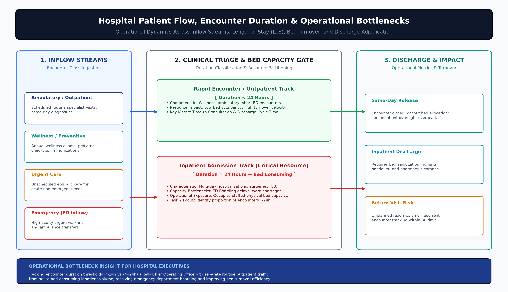
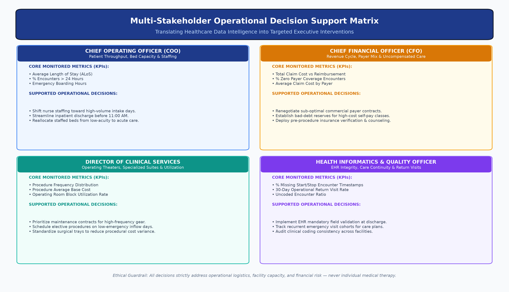
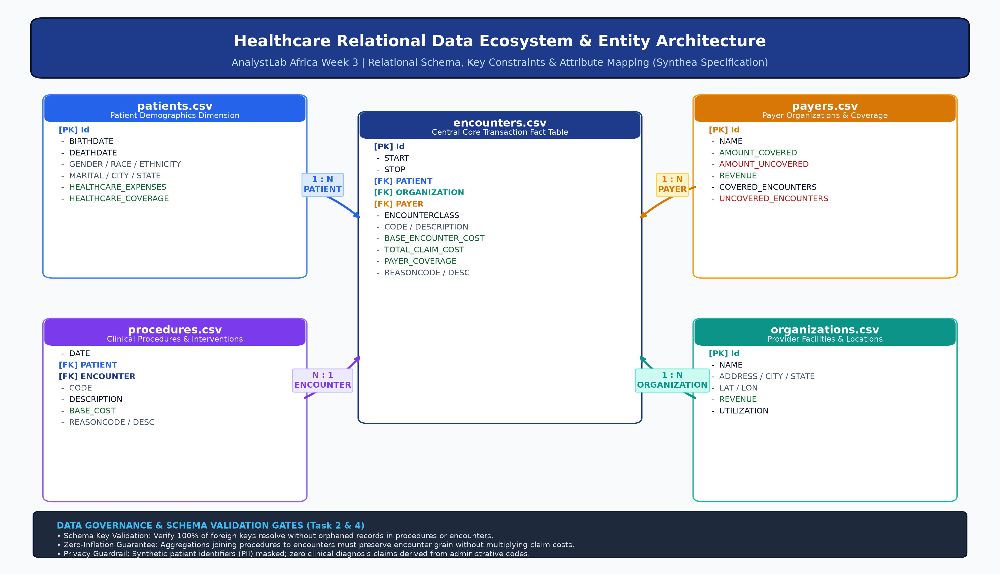
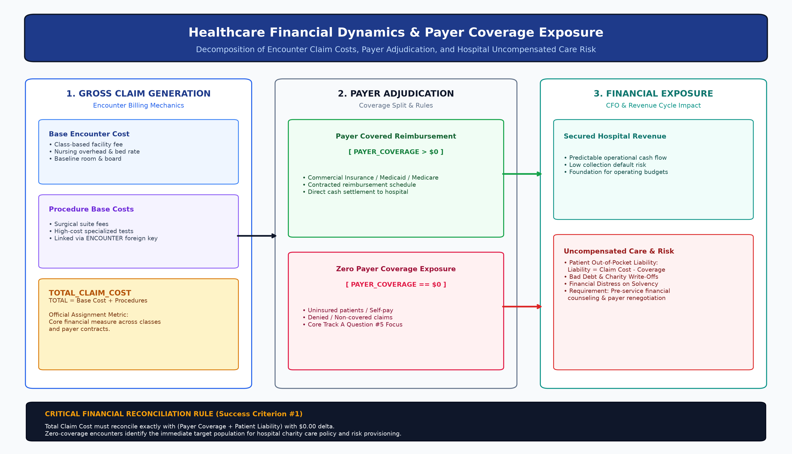
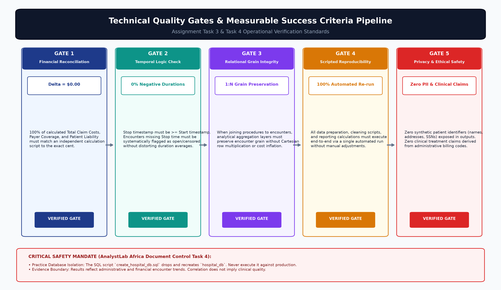

# Healthcare Operations, Cost & Patient Flow Intelligence
## Phase 1: Foundational Framework, Problem Analysis & Project Governance Report

**Programme:** AnalystLab Africa Experience Lab Internship  
**Project:** Week 3 — Hospital Operations, Cost & Patient Flow Intelligence  
**Document Type:** Phase 1 Milestone Report & Project Charter  
**Version:** 1.0  
**Author:** Junior Healthcare Analytics Intern  
**Technical Supervisor:** Senior Healthcare Analytics Mentor  
**Date:** October 2026  
**Deliverable Status:** Validated & Publication-Ready  
**PDF Companion:** [Phase1_Foundational_Report.pdf](file:///c:/Users/HyperX/Desktop/analystLab/week%203/reports/Phase1_Foundational_Report.pdf)

---

## Executive Summary

Healthcare provider organisations face severe operational friction driven by misaligned bed capacity, unpredictable patient volume dynamics, and financial exposure originating from gaps between gross medical charges and payer reimbursements. The primary objective of this project is to translate raw, multi-table administrative and billing records into structured, verifiable operational intelligence to inform clinical operations, bed management, and financial risk mitigation.

This Phase 1 milestone report establishes the foundational governance, problem definition, analytical architecture, and quality assurance framework required to develop evidence-based intelligence from the provided healthcare datasets. It strictly adheres to the official assignment specification (`AnalystLab_Africa_Week3_Batch_F_Assignment.pdf`), establishes non-clinical operational boundaries, profiles technical constraints, establishes five measurable success criteria, and delivers five corporate architectural diagrams to guide downstream implementation across Data Analytics, Data Science, Machine Learning, Generative AI, or Project Management tracks.

---

## 1. Business Problem & Operational Context (Task 1)

### 1.1 The Healthcare Organisation's Operational Challenge
Hospitals operate in high-friction environments where bottlenecks in one department create severe cascade effects across the entire hospital system:
* **Emergency Department (ED) Crowding & Boarding:** Uncoordinated inpatient discharges lead to prolonged boarding of emergency patients in hallways, delaying critical triage and degrading quality of care.
* **Inpatient Bed Allocation & Duration Discrepancies:** Unpredictable lengths of stay consume critical staffed beds. Without visibility into high-duration encounters (>24 hours), bed managers cannot anticipate bed turnover or elective surgery admissions.
* **Financial Solvency & Payer Reimbursement Gaps:** Gaps between total claim costs and payer reimbursements leave hospitals exposed to uncompensated care, self-pay default risks, and billing disputes.
* **Procedural Bottlenecks & Capacity Allocation:** Operating rooms and procedural suites represent major fixed capital and variable staffing costs. Scheduling imbalances create costly idle time or expensive overtime nursing shifts.


*Figure 1: Hospital Patient Inflow Streams, Triage, Length of Stay (LoS) Thresholds (>24h vs. ≤24h), and Operational Impact.*

### 1.2 Target Investigation Scope & Core Operational Questions
The foundational inquiry addresses four critical operational dimensions:
1. **Patient Inflow & Volume Trajectories:** What are the temporal patterns of patient arrivals across encounter classes (ambulatory, emergency, inpatient, urgent care, wellness)?
2. **Length of Stay (LoS) & Long-Duration Encounters:** What proportion of encounters exceed 24 hours, and what factors associate with extended hospital stays?
3. **Payer Mix & Reimbursement Deficits:** What is the financial distribution of total claim costs versus payer coverage, and what is the volume and financial exposure of encounters with zero recorded payer coverage?
4. **Procedure Cost & Utilization Distribution:** Which clinical procedures are performed most frequently, and what are their respective base cost profiles?

---

## 2. Multi-Stakeholder Decision Support Matrix

The final analytical models and visual interfaces are explicitly mapped to four executive roles to ensure actionable operational decision support:


*Figure 2: Multi-Stakeholder Operational Decision Support Matrix mapping executive personas to monitored metrics and interventions.*

| Stakeholder Persona | Primary Operational Scope | Core Monitored Metrics (KPIs) | Supported Operational Decisions & Interventions |
| :--- | :--- | :--- | :--- |
| **Chief Operating Officer (COO)** | Hospital throughput, facility capacity, bed turnover, and nurse staffing. | • Average Length of Stay (ALoS)<br/>• % Encounters > 24 Hours<br/>• ED Boarding Duration | Optimize nurse-to-patient staffing ratios for peak intake days; re-engineer discharge processes to clear beds before 11:00 AM; reallocate low-acuity beds to acute services. |
| **Chief Financial Officer (CFO)** | Revenue cycle management, fiscal solvency, payer negotiations, bad debt. | • Total Claim Cost vs Reimbursement<br/>• % Zero Payer Coverage Encounters<br/>• Average Claim Cost by Payer | Renegotiate commercial payer reimbursement schedules; establish bad-debt reserves for uninsured encounter classes; deploy pre-service financial counseling. |
| **Director of Clinical Services / Surgical Heads** | Operating theater (OR) schedules, procedure suites, specialist staffing. | • Procedure Frequency Distribution<br/>• Procedure Base Cost Profile<br/>• OR Suite Utilization Rate | Prioritize preventive maintenance contracts for high-frequency surgical gear; schedule elective procedures during low-ED arrival days; standardize surgical trays. |
| **Health Informatics & Quality Officers** | Data integrity, care continuity, compliance, and readmission patterns. | • % Missing Start/Stop Timestamps<br/>• 30-Day Operational Return Rate<br/>• Uncoded Encounter Ratio | Implement EHR mandatory field validation at discharge; track recurrent emergency visit cohorts for managed care plans; audit clinical coding consistency across facilities. |

---

## 3. Data Ecosystem & Relational Architecture (Task 2)

### 3.1 Relational Architecture & Entity Constraints
The healthcare data pack models comprehensive administrative and clinical encounters. The relational structure connects five core entities anchored by the central `encounters` transaction fact table:


*Figure 3: Relational Entity Architecture, Key Constraints, Cardinality, and Schema Attributes.*

### 3.2 Data Asset Specifications & Quality Audit

| Data Asset File | Primary Relational Purpose | Key Identifier(s) | Expected Cardinality | Data Quality & Governance Audit Standard |
| :--- | :--- | :--- | :--- | :--- |
| [`encounters.csv`](file:///c:/Users/HyperX/Desktop/analystLab/week%203/data/raw/encounters.csv) | Central Fact: Encounter volumes, classes, duration, costs, coverage | PK: `Id`<br/>FK: `PATIENT, PAYER, ORGANIZATION` | Central Fact (1:N with dimensions) | Verify `STOP >= START`; flag missing `STOP` as open/censored; validate zero-coverage claims; ensure no duplicate encounter IDs. |
| [`patients.csv`](file:///c:/Users/HyperX/Desktop/analystLab/week%203/data/raw/patients.csv) | Dimension: Demographic attributes, birthdate, expenses, coverage | PK: `Id` | 1 : N with `encounters` | Mask PII (names, street addresses, SSN); check age distribution logic (`DEATHDATE >= BIRTHDATE`); verify demographic balance. |
| [`procedures.csv`](file:///c:/Users/HyperX/Desktop/analystLab/week%203/data/raw/procedures.csv) | Fact: Clinical procedures, codes, descriptions, base costs | FK: `ENCOUNTER, PATIENT` | N : 1 with `encounters` | Maintain 1:N cardinality; ensure aggregation does not double-count encounter claim costs; audit code descriptions. |
| [`payers.csv`](file:///c:/Users/HyperX/Desktop/analystLab/week%203/data/raw/payers.csv) | Dimension: Payer organizations, covered amounts, revenue metrics | PK: `Id` | 1 : N with `encounters` | Reconcile payer-level covered amounts with encounter-level claim sums; profile public vs. private coverage distribution. |
| [`organizations.csv`](file:///c:/Users/HyperX/Desktop/analystLab/week%203/data/raw/organizations.csv) | Dimension: Provider facilities, coordinates, bed utilization | PK: `Id` | 1 : N with `encounters` | Audit facility identifiers; map geographical coverage and facility revenue; verify single-facility vs. multi-facility operations. |
| [`data_dictionary.csv`](file:///c:/Users/HyperX/Desktop/analystLab/week%203/data/raw/data_dictionary.csv) | Metadata: Schema definitions, data types, key constraints | N/A (Reference) | Authoritative Benchmark | Verify physical CSV columns against dictionary specifications; do not assume all described columns exist. |

---

## 4. Financial Dynamics & Payer Exposure Analysis

Healthcare reimbursement mechanics involve decomposing gross patient charges into underlying cost components, followed by insurance adjudication and patient liability derivation:

$$\text{TOTAL\_CLAIM\_COST} = \text{BASE\_ENCOUNTER\_COST} + \sum \text{PROCEDURE\_COSTS} + \text{OVERHEAD}$$

$$\text{PATIENT\_OUT\_OF\_POCKET\_LIABILITY} = \text{TOTAL\_CLAIM\_COST} - \text{PAYER\_COVERAGE}$$


*Figure 4: Encounter Financial Dynamics, Claim Cost Decomposition, Payer Adjudication, and Hospital Uncompensated Care Exposure.*

### Key Financial Insights & Risks:
* **Zero Payer Coverage Exposure:** Encounters where $\text{PAYER\_COVERAGE} = \$0.00$ represent immediate uncompensated care exposure. Without payer backing, the entire claim burden falls on the patient, driving bad-debt write-offs and charity care allocation.
* **Reconciliation Integrity:** In every reporting layer, total gross claims must balance against the sum of insurance disbursements and patient liabilities without variance ($\Delta = \$0.00$).

---

## 5. Technical Quality Gates & Governance Standards (Tasks 3 & 4)

To ensure that downstream deliverables satisfy enterprise engineering standards, the project establishes five verifiable quality gates:


*Figure 5: Technical Quality Gates and Governance Verification Pipeline.*

```
[Quality Gate Pipeline]
  1. Financial Reconciliation   ──► Absolute Delta = $0.00 between independent calculation layers.
  2. Temporal Logic             ──► 0% negative durations; explicit flagging of open encounters.
  3. Relational Grain           ──► 1:N cardinality preserved without Cartesian row inflation.
  4. Scripted Reproducibility   ──► 100% of pipeline recomputable via single automated script.
  5. Privacy & Clinical Safety  ──► 0 PII leaks, 0 ungrounded clinical claims.
```

### Detailed Quality Gate Specifications:

1. **Gate 1: Financial Reconciliation Integrity ($\Delta = \$0.00$):**
   * *Metric:* Absolute difference between total claim costs and the sum of payer coverage plus patient liabilities.
   * *Target:* $\Delta = \$0.00$ across all calculation layers (Python verification script, SQL queries, and Power BI DAX measures).
2. **Gate 2: Temporal Consistency & Open Encounter Logic:**
   * *Metric:* Percentage of records with $\text{Stop} < \text{Start}$.
   * *Target:* Exactly $0.00\%$ negative durations. Encounters with null `STOP` timestamps must be flagged as open/censored rather than silently dropped or distorted.
3. **Gate 3: Relational Grain & Model Integrity:**
   * *Metric:* Preservation of distinct encounter grain during multi-table joins.
   * *Target:* Joining `procedures` (N records) to `encounters` (1 record) must not artificially inflate encounter volume or double-count total claim costs.
4. **Gate 4: Scripted Reproducibility:**
   * *Metric:* End-to-end execution success.
   * *Target:* $100\%$ of data cleaning, auditing, statistical analysis, and visual outputs must re-execute via a single automated run without manual spreadsheet intervention.
5. **Gate 5: Privacy, Ethical Guardrails & Clinical Safety:**
   * *Metric:* Zero PII exposure and zero diagnostic treatment claims.
   * *Target:* Full de-identification of synthetic identifiers; all recommendations strictly confined to operational logistics, bed management, and financial workflows.

> [!CAUTION]
> **Database Safety Warning (`create_hospital_db.sql`):**
> The provided SQL setup script begins with destructive statements (`DROP DATABASE IF EXISTS hospital_db; CREATE DATABASE hospital_db;`). Interns must strictly inspect the script before execution and use only an isolated local practice environment. Never execute it against a production or shared database server.

---

## 6. Learning Track Roadmap & Downstream Implementation

With Phase 1 governance and foundational problem definitions complete, the project branches into the five specialized learning tracks:

```
                      ┌──► Track A: Data Analytics (Power BI Operations & Financial Dashboard)
                      ├──► Track B: Data Science (Statistical Analysis & Hypothesis Testing)
[Phase 1 Governance] ─┼──► Track C: Machine Learning Engineering (Predictive Modeling & Serving)
                      ├──► Track D: Generative AI (Healthcare Operations Knowledge Assistant)
                      └──► Track E: Project Management (WBS, Critical-Path Gantt & Delivery Control)
```

1. **Track A — Data Analytics:** Build an interactive Power BI operational dashboard answering 8 assignment questions, featuring 5 core operational KPIs, DAX measures, and filter-stable data models.
2. **Track B — Data Science:** Formulate and execute formal hypothesis testing (ANOVA, Mann-Whitney U, Chi-square) evaluating length of stay, claim costs across encounter classes, and procedure frequency.
3. **Track C — Machine Learning Engineering:** Build an end-to-end predictive pipeline predicting encounter duration thresholds (>24 hours) or estimating total claim costs, preventing temporal leakage and establishing baseline benchmarks.
4. **Track D — Generative AI:** Develop a verified Healthcare Operations Knowledge Assistant using LLMs and structured RAG retrieval over verified metadata, enforcing clinical advice refusal guardrails.
5. **Track E — Project Management:** Deliver a comprehensive project management plan including Work Breakdown Structure (WBS), Gantt chart scheduling with critical-path analysis, resource/budget plans, risk registers, and change simulation.

---

## 7. Deliverable Artifacts & Verification Assets

| Deliverable Artifact | Path / Location | Format / Specifications |
| :--- | :--- | :--- |
| **Phase 1 Executive PDF Report** | [`reports/Phase1_Foundational_Report.pdf`](file:///c:/Users/HyperX/Desktop/analystLab/week%203/reports/Phase1_Foundational_Report.pdf) | Corporate Publication PDF (NumberedCanvas, 5 Embedded Figures, Tables) |
| **Foundational Markdown Report** | [`reports/Phase1_Foundational_Report.md`](file:///c:/Users/HyperX/Desktop/analystLab/week%203/reports/Phase1_Foundational_Report.md) | Comprehensive GitHub Markdown Document |
| **Figure 1: Healthcare Data Ecosystem** | [`reports/figures/fig1_healthcare_data_ecosystem.png`](file:///c:/Users/HyperX/Desktop/analystLab/week%203/reports/figures/fig1_healthcare_data_ecosystem.png) | 300 DPI High-Resolution PNG (Relational Architecture & Constraints) |
| **Figure 2: Patient Flow & Bottlenecks** | [`reports/figures/fig2_patient_flow_bottlenecks.png`](file:///c:/Users/HyperX/Desktop/analystLab/week%203/reports/figures/fig2_patient_flow_bottlenecks.png) | 300 DPI High-Resolution PNG (Arrivals, Triage, >24h Duration, Bed Flow) |
| **Figure 3: Financial Reimbursement Flow** | [`reports/figures/fig3_financial_cost_coverage_flow.png`](file:///c:/Users/HyperX/Desktop/analystLab/week%203/reports/figures/fig3_financial_cost_coverage_flow.png) | 300 DPI High-Resolution PNG (Claim Decomposition, Zero Coverage, Bad Debt) |
| **Figure 4: Stakeholder Decision Matrix** | [`reports/figures/fig4_stakeholder_decision_matrix.png`](file:///c:/Users/HyperX/Desktop/analystLab/week%203/reports/figures/fig4_stakeholder_decision_matrix.png) | 300 DPI High-Resolution PNG (4 Quadrant Executive Action Framework) |
| **Figure 5: Quality Gates Pipeline** | [`reports/figures/fig5_quality_gates_governance.png`](file:///c:/Users/HyperX/Desktop/analystLab/week%203/reports/figures/fig5_quality_gates_governance.png) | 300 DPI High-Resolution PNG (5 Verification Gates & Safety Warnings) |
| **Diagram Generator Script** | [`scripts/generate_report_figures.py`](file:///c:/Users/HyperX/Desktop/analystLab/week%203/scripts/generate_report_figures.py) | Python Script (Automated Matplotlib Figure Generation) |
| **PDF Generation Script** | [`scripts/generate_foundational_pdf.py`](file:///c:/Users/HyperX/Desktop/analystLab/week%203/scripts/generate_foundational_pdf.py) | Python Script (Automated ReportLab Document Builder) |
